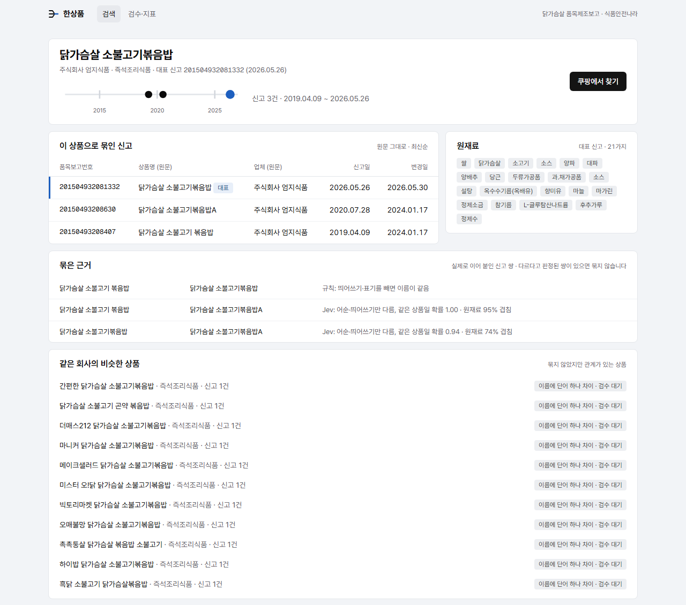
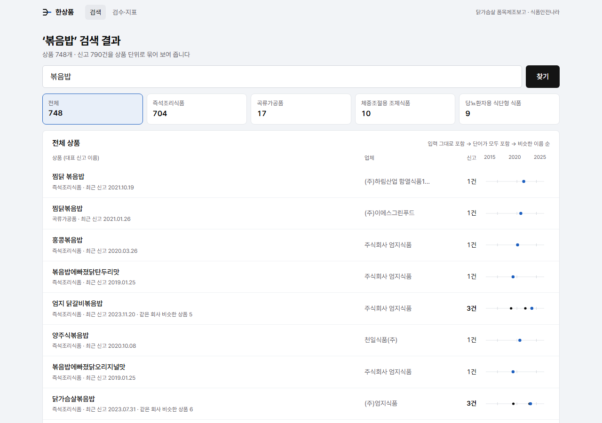

# 한상품 — 공공데이터 품목제조보고를 소비자 상품 단위로 묶기

식품안전나라 품목제조보고는 공장·재신고마다 레코드가 따로 쌓여서, 같은 상품이 여러 줄로 흩어져 보인다.
규칙 + Jev 판정 + 사람 검수로 이 레코드들을 **같은 상품 / OEM 형제 / 다른 상품**으로 나눠 묶는다.

**사이트** https://hansangpum.vercel.app · **스택** Next.js 16 · Vercel · Supabase Postgres + Drizzle · pg_trgm · TypeSafe Jev · Vitest

## 30초 요약

| | |
| --- | --- |
| **문제** | 같은 상품이 공장별·재신고별 레코드로 흩어진다. 검색에 같은 상품이 반복되고, 이미지·링크를 레코드마다 따로 붙여야 한다 |
| **해결** | 규칙이 확실한 쌍을 정하고, 애매한 쌍만 Jev가 확률로 판정한다. 그래도 애매하면 사람 검수로 넘긴다. 결과를 union-find로 묶는다 |
| **결과** | 닭가슴살 5,128건 → 4,837개 상품. 최종 시험(규칙 동결, 170쌍) **정밀도 92.0% · 재현율 81.4%**. 검수 106쌍을 반영하자 재현율이 85.7%로 올랐다 |
| **핵심 발견** | OEM 공장이 같은 레시피를 여러 브랜드로 낸다 → "같다/다르다"가 아니라 세 갈래가 필요했다 |
| **서비스** | 검색·상세·검수 어드민·행동 로그를 운영한다. Jev 판정 비용은 $0.13 |

## 화면

**상품 상세:** 엄지식품의 신고 3건(2019·2020·2026)을 한 상품으로 묶었다. 묶은 근거로는 규칙 1쌍과 Jev 2쌍을 확률과 함께 보여 준다. 아래 "같은 회사의 비슷한 상품"에는 같은 공장이 마니커·하이밥·흑닭 등 여러 브랜드로 낸 상품이 OEM 형제 후보로 묶이지 않고 링크로만 남아 있다.



**검색:** 신고 790건을 상품 748개 단위로 보여 준다. 오른쪽 점은 묶인 신고들이 언제 들어왔는지를 나타낸다.



## 어떻게 동작하나

```
수집 → 정제 → 후보 쌍 → 규칙 ─┬─ 확실히 같음 ─────────────────┐
                              ├─ 확실히 다름 (cannot-link)    ├→ 묶기 → 적재 → 검색·상세
                              └─ 애매함 → Jev ─┬─ 자동 ───────┘
                                               └─ 검수 대기 → /admin 사람 판정 → 다시 묶기
```

1. **정제:** 이름에서 중량·보관·포장·이유식 단계를 떼어 따로 두고, 업체명에서 법인·공장 표기를 뗀다.
2. **후보 쌍:** 같은 회사 계열 안에서만 비교한다. 점수는 이름 유사도와 원재료 겹침으로 낸다.
3. **규칙이 먼저:** 이름이 같으면 묶고, 숫자·단계·글자가 다르면 따로 둔다. 코드로 알 수 있는 차이는 규칙이 맡는다.
4. **Jev는 애매한 쌍만:** 세 관계의 확률을 받아 어순·띄어쓰기만 다른 쌍만 자동으로 묶는다. 나머지는 검수로 보낸다.
5. **묶기:** union-find로 묶되, cannot-link와 묶음 사이 다수결로 판정 하나가 다리가 되어 다른 상품이 섞이는 것을 막는다.

자세히: [문제와 접근](docs/approach.md)

## 결과

| 지표 | 값 |
| --- | --- |
| 정밀도 (자동으로 묶은 쌍이 정말 같은 상품) | **92.0%** (46/50, 95% 신뢰구간 약 81~97%) |
| 재현율 (같은 상품 쌍 중 자동으로 묶은 것) | **81.4%** |
| 검수 포함 재현율 | 100% (못 묶은 5쌍 모두 검수 대기) |

- 규칙을 동결(코드·결과 해시 기록)하고, 앞선 정답셋 레코드를 빼고, 한 번만 쟀다.
- 그 전에는 정답셋을 보며 규칙을 고친 탓에 재현율이 85~92%로 부풀어 있었다. 새 표본으로 재자 59%였다.
- 누구나 같은 숫자를 다시 낼 수 있다.
- **검수 106쌍 반영 후**(지금 사이트): 정밀도 92.6% · 재현율 85.7%. 이 숫자는 검수 중 바로잡은 시험 라벨 1개를 반영한 값이다. 그 라벨은 Claude가 "다름"으로 달았지만 원재료가 같았다. 검수 판정은 사람 대신 Claude가 했다.

자세히: [평가](docs/evaluation.md) · [정답셋](data/labels/README.md)

## 발견

- **OEM 형제:** 이름과 원재료가 거의 같아도 브랜드가 다르면 소비자에게는 다른 상품이다.
- **Jev가 높은 확신으로 틀린 쌍은 "이름 글자 차이" 유형이었다**(된죽↔죽, 덮밥 400↔500). 그래서 이런 차이는 규칙으로 옮겼다.
- **배포 후 장애:** Vercel 함수가 동결됐다 깨면서 끊긴 DB 연결 때문에 최대 75초 멈췄다. 연결을 1개로 묶어서 동시 쿼리도 멈췄다. 둘 다 원인을 찾아 고쳤다.

자세히: [발견과 교훈](docs/lessons.md)

## 한계

- **라벨러 = 규칙 설계자.** 정답셋 360쌍은 모두 Claude가 직접 라벨했다. 검수 106쌍도 Claude가 했다. 사람이 시험 삼아 판정한 쌍 하나가 Claude 라벨의 오류를 찾았는데, 이 사례가 사람 검수가 필요한 이유를 보여 준다.
- **같은 회사 계열 안에서만 비교한다.** 다른 회사가 낸 같은 상품은 후보에 오르지 않는다.
- **닭가슴살 한 카테고리, C002만 다뤘다.** 축산물(C006)이 빠져 햄·소시지 같은 가공 닭가슴살이 없다.
- **표본이 작다.** 자동 묶음 표본 50쌍이라 정밀도 신뢰구간이 넓다.

확장 방향: [확장 계획](docs/scaling.md) (165만 건 규모, 증분 처리, Parquet·DuckDB, Elasticsearch)

## 폴더 구조

```
scripts/        파이프라인 단계별 실행
  ingest.mjs      수집 (식품안전나라 Open API, C002 식품 · C006 축산물)
  normalize.ts    정제
  candidates.ts   후보 쌍 + 규칙 점수
  judge.ts        애매한 쌍 Jev 판정 (쌍 키 캐시)
  run-grouping.ts 묶기 (규칙 + Jev + 사람 판정)
  pull-human.ts   /admin 사람 판정 내려받기
  load.ts         Supabase 적재
  eval/           정답셋 표본 뽑기·평가 (1차 · 2차 · 최종 시험)
lib/            핵심 로직 (단위 테스트 46개)
  normalize.ts · score.ts · judge.ts · group.ts
  web/            화면용 조회 · 검수 · 요청 횟수 제한
app/            Next.js 화면: 검색 · 상품 상세 · /admin · /api/events
db/             Drizzle 스키마 + 마이그레이션 (전 표 RLS)
data/labels/    정답셋 360쌍
docs/           접근 · 평가 · 발견과 교훈 · 확장 계획
```

## 실행

```bash
npm install
cp .env.example .env                                   # 키 채우기
node scripts/ingest.mjs 닭가슴살 <조건...>              # 수집 → data/raw/
node scripts/normalize.ts 닭가슴살 --services=C002      # 정제 (기본은 C002·C006 모두)
node scripts/candidates.ts 닭가슴살                     # 후보 쌍·규칙 점수
node scripts/judge.ts 닭가슴살                          # Jev 판정
node scripts/run-grouping.ts 닭가슴살                   # 묶기
node scripts/eval/final-evaluate.ts 닭가슴살            # 최종 시험 다시 재기
node scripts/load.ts 닭가슴살                           # Supabase 적재
npm run regroup                                        # 사람 판정 반영 → 묶기 → 적재
npm test · npm run dev
```

## 데이터 출처와 주의

- **출처:** 식품의약품안전처 식품안전나라 Open API 품목제조보고(원재료) C002. 정답셋에는 실제 상품명·업체명이 들어 있다. 원본 수집 데이터는 저장소에 넣지 않았다.
- **주의:** 포트폴리오용 실험이다. 묶음과 OEM 형제 링크는 자동 판정이라 틀릴 수 있고, 업체의 실제 제조·위탁 관계를 확인한 정보가 아니다.
- **남용 방지:** `/api/events`는 IP마다 1분 60건, `/admin` 로그인은 IP마다 2시간 5번까지 받는다. IP는 저장하지 않고 해시만 센다.
